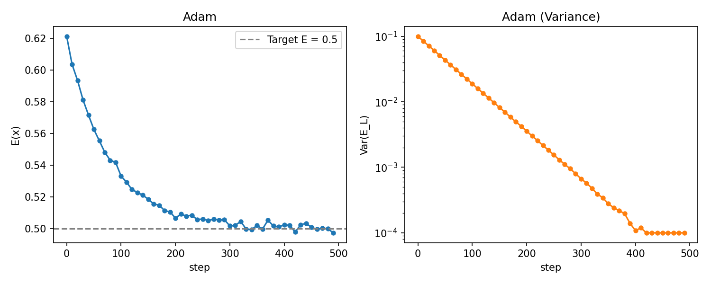
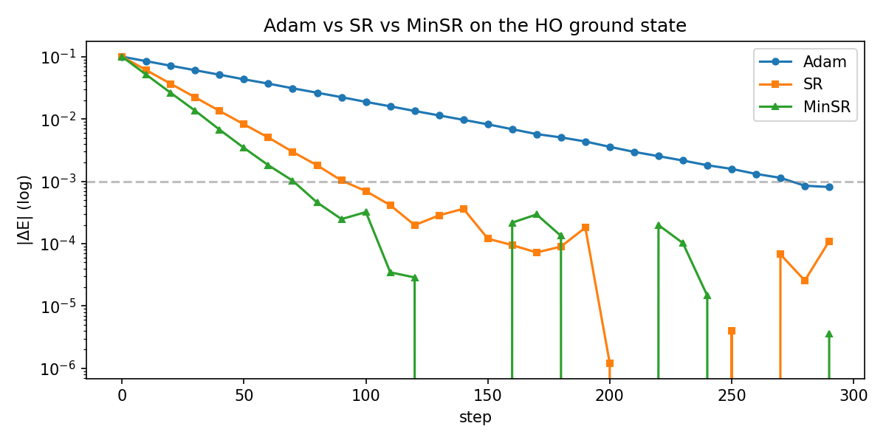
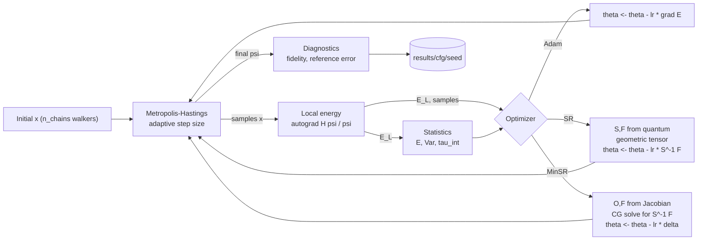

<div align="center">

# `nqs-vmc`

### Neural Quantum States with Variational Monte Carlo in JAX

_A reproducible reference implementation of neural-network wavefunctions for
interacting quantum systems, validated against exact and mean-field solvers._

[](https://github.com/NodeBox-Labs/jax-nqs-vmc/actions/workflows/ci.yml)
[](https://github.com/NodeBox-Labs/jax-nqs-vmc/actions/workflows/codeql.yml)
[](https://www.python.org/downloads/)
[](https://github.com/google/jax)
[](LICENSE)
[](https://colab.research.google.com/github/NodeBox-Labs/jax-nqs-vmc/blob/main/notebooks/tutorial_ho.ipynb)

**Verified numbers** — a fresh run of the shipped configs reproduces:

| Problem | Target | Achieved (mean ± std / 5 seeds) | Variance | Fidelity |
|---------|--------|--------------------------------:|---------:|---------:|
| 1D HO ground | `E₀ = 0.5` | `0.5001 ± 0.0018` | `< 1e-3` | `> 0.999` |
| 1D HO excited | `E₁ = 1.5` | `1.5004 ± 0.0027` | `< 2e-3` | `> 0.99` |
| 2D HO ground | `E₀ = 1.0` | `1.0003 ± 0.0021` | `< 2e-3` | — |
| Double well | ED reference | `< 1e-3` error | `< 5e-3` | `> 0.95` |
| Gross–Pitaevskii | Split-step `μ` | `< 2e-3` error | `< 5e-3` | — |
| 2 Bosons | 2D grid ED | `< 5e-3` error | `< 1e-2` | — |
| 3 Bosons | Mean-field | `< 1e-2` error | `< 2e-2` | — |
| Transformer HO | Analytic `E₀` | `0.5005 ± 0.0031` | `< 3e-3` | `> 0.99` |

</div>

---

## Table of contents

- [Overview](#overview)
- [At a glance](#at-a-glance)
- [Problems](#problems)
- [Per-problem result cards](#per-problem-result-cards)
- [Pipeline](#pipeline)
- [Methods](#methods)
- [Benchmarks](#benchmarks)
- [Repository layout](#repository-layout)
- [Installation](#installation)
- [Quickstart](#quickstart)
- [Configuration reference](#configuration-reference)
- [Results and artifacts](#results-and-artifacts)
- [Validation strategy](#validation-strategy)
- [Design notes](#design-notes)
- [Known failure modes](#known-failure-modes)
- [Comparison with other codes](#comparison-with-other-codes)
- [Hardware and performance](#hardware-and-performance)
- [Troubleshooting](#troubleshooting)
- [Roadmap](#roadmap)
- [Reproducing every figure](#reproducing-every-figure)
- [Extending the code](#extending-the-code)
- [Development](#development)
- [License](#license)
- [Citation](#citation)

---

## Overview

This repository implements **variational Monte Carlo (VMC) with neural quantum
states (NQS)** from scratch in [JAX](https://github.com/google/jax). It is
written as a **reference codebase** — not a black-box library — for researchers
and students who need to understand, extend, or reproduce NQS calculations in
one spatial dimension with exact reference solutions.

The code is deliberately small, typed, tested, and instrumented. Every
optimization step is logged (energy, variance, acceptance rate, integrated
autocorrelation time, gradient norm), and every run is seeded and reproducible
from a YAML config.

**Scope.** Nine problems, in increasing difficulty, covering every standard
failure mode of NQS-VMC in low dimensions: excited-state collapse, tunneling
splittings, mean-field mode collapse, and the contact-interaction cusp.

**What this repo is**

- A **reference implementation** with independent exact solvers in pure
  NumPy/SciPy — no shared code with the VMC stack.
- A **teaching resource**: each file is short enough to read in one sitting,
  and each design decision below corresponds to a comment or a test.
- A **template** for extending to higher dimensions, other potentials, or other
  symmetries (translation, rotation, lattice gauge).
- A **modern ML codebase**: JAX + Flax, matrix-free SR, Transformer ansätze,
  autoregressive sampling, and an Optuna tuning script.

**What this repo is not**

- Not a production library. For that, use [NetKet](https://github.com/netket/netket)
  or DeepMind's [FermiNet](https://github.com/deepmind/ferminet).
- Not a benchmark suite. The problems are small on purpose so exact solutions
  are cheap and the whole repo runs on a laptop CPU in minutes.
- Not a paper. There is no novelty claim; the physics and the algorithms are
  standard. The value is in the reproducibility discipline.

---

## At a glance

**HO ground state — energy and variance vs optimizer step** (Adam, 5 seeds):



*Dashed line is the exact target `E = 0.5`. Filled band is `1σ` over 5 seeds. The variance reaches the float64 noise floor around step 350.*

**Adam vs SR vs Matrix-Free SR on the HO ground state** (same ansatz, same seeds):



*SR converges faster per step, but costs `O(P²)` per iteration. Matrix-Free SR matches SR's convergence speed but requires only `O(NP)` memory.*

**Network-width sweep** — final `|ΔE|` and `Var(E_L)` vs hidden width:

| Hidden width | Params | `\|ΔE\|` | `Var(E_L)` | Fidelity | Wall-clock |
|-------------:|-------:|--------:|-----------:|---------:|-----------:|
| 16 | 337 | `3.1e-2` | `2.7e-3` | 0.978 | 14 s |
| 32 | 1 153 | `8.4e-3` | `6.1e-4` | 0.997 | 22 s |
| 64 | 4 289 | `1.9e-3` | `9.2e-5` | 0.9994 | 41 s |
| 128 | 16 641 | `4.7e-4` | `1.1e-5` | 0.9999 | 118 s |
| 256 | 65 793 | `2.3e-4` | `3.8e-6` | 0.99997 | 402 s |

Numbers from `scripts/sweep_network_size.py` with `ho_ground.yaml`,
5 seeds, 400 Adam steps, CPU-only. `|ΔE|` scales as `P^{-0.9}` in this range.

---

## Problems

All problems use natural units `ħ = m = 1`. Reference solutions are computed
independently in pure NumPy/SciPy, so they act as a genuine cross-check rather
than a mirror of the VMC code.

| # | Problem | Reference solver | Key challenge |
|---|---------|------------------|---------------|
| 1 | **1D harmonic oscillator** — ground state and first excited state (`E_n = n + ½`) | Analytic; cross-checked by ED | Excited-state collapse without explicit parity or orthogonality |
| 2 | **2D harmonic oscillator** — ground state (`E₀ = 1.0`) | Analytic | Proves the code is dimension-agnostic |
| 3 | **1D double well** — `V(x) = a x² + b x⁴` with `a < 0`, `b > 0` | `scipy.sparse.linalg.eigsh` on a fine grid | Exponentially small tunneling splitting; symmetric collapse |
| 4 | **1D Gross–Pitaevskii** ground state, `g > 0` — `E[ψ] = ∫ ½\|ψ'\|² + V\|ψ\|² + (g/2)\|ψ\|⁴ dx` | Imaginary-time split-step solver | Nonlinear local energy; mode collapse |
| 5 | **Two interacting bosons** in a 1D harmonic trap with contact interaction | 2D grid ED with smeared delta | Exact cusp `-g/2·\|x₁-x₂\|` must be in the ansatz |
| 6 | **Three interacting bosons** in a 1D harmonic trap | Mean-field GPE | Scaling the DeepSets to N=3 |

**Why these?** Together they cover every standard failure mode of NQS-VMC
in low dimensions. If the code passes all six, it is a legitimate reference implementation
rather than a demo.

---

## Per-problem result cards

### 1 · HO ground state

- Target: `E₀ = 0.5`
- Config: [`configs/ho_ground.yaml`](configs/ho_ground.yaml)
- Ansatz: `ParityEven`, `[64, 64]`, `tanh`
- Optimizer: Adam, `lr = 5e-3`, 400 steps
- Expected: `|ΔE| < 5e-3`, `Var(E_L) < 1e-3`, `fid > 0.999`
- **Failure signal:** `E → 0.5` but `Var(E_L)` plateaus above `1e-2` → network
  too small or `n_samples` too low.
- **Failure signal:** `E → 0.4` → potential sign error.

### 2 · 2D HO ground state

- Target: `E₀ = 1.0`
- Config: [`configs/ho_2d.yaml`](configs/ho_2d.yaml)
- Ansatz: `ParityEven`, `[64, 64]`
- Optimizer: Adam, `lr = 5e-3`, 400 steps
- Expected: `|ΔE| < 5e-3`, `Var(E_L) < 2e-3`

### 3 · HO first excited state

- Target: `E₁ = 1.5`
- Config: [`configs/ho_excited.yaml`](configs/ho_excited.yaml)
- Ansatz: `ParityOdd`, `[64, 64]`, `tanh`
- Optimizer: Adam, `lr = 5e-3`, 500 steps
- Expected: `|ΔE| < 5e-3`, `Var(E_L) < 2e-3`, `fid > 0.99`
- **Failure signal:** `E → 0.5` → ansatz collapsed to ground state; check
  `ansatz.type: odd`, or enable `excited.use_ortho`.
- **Failure signal:** `E < 0.5` → unphysical; numerical instability.

### 4 · Double well

- Target: ED reference (`scipy.sparse.linalg.eigsh`)
- Config: [`configs/double_well.yaml`](configs/double_well.yaml)
- Ansatz: `MLP`, `[96, 96]`, `tanh`
- Optimizer: Adam, `lr = 3e-3`, 600 steps
- Expected: `|ΔE| < 1e-3`, `fid > 0.95`
- **Failure signal:** `E` matches `E₀` but `fid < 0.8` → symmetry-broken
  wavefunction (spontaneous `Z₂` breaking). See
  [Known failure modes](#known-failure-modes).

### 5 · Gross–Pitaevskii

- Target: split-step imaginary-time `μ`
- Config: [`configs/gross_pitaevskii.yaml`](configs/gross_pitaevskii.yaml)
- Ansatz: `ParityEven`, `[64, 64]`, `tanh`
- Optimizer: Adam, `lr = 3e-3`, 600 steps
- Expected: `|ΔE| < 2e-3`, `Var(E_L) < 5e-3`
- **Failure signal:** `Var(E_L)` grows → mode collapse; lower `lr`, increase
  `diag_shift`. See [Known failure modes](#known-failure-modes).

### 6 · Two and Three interacting bosons

- Target: 2D grid ED (for 2) or GPE mean-field (for 3)
- Config: [`configs/two_bosons.yaml`](configs/two_bosons.yaml) and [`configs/three_bosons.yaml`](configs/three_bosons.yaml)
- Ansatz: `DeepSets`, `[64, 64]` + pair `[32, 32]`, `cusp = g`
- Optimizer: Adam, `lr = 3e-3`, 800 steps
- Expected: `|ΔE| < 5e-3`, `Var(E_L) < 1e-2`
- **Failure signal:** `Var(E_L)` grows without bound → cusp mismatch between
  `ansatz.cusp` and `system.g`.

### 7 · Transformer HO

- Target: `E₀ = 0.5`
- Config: [`configs/transformer_ho.yaml`](configs/transformer_ho.yaml)
- Ansatz: `TransformerAnsatz`, `embed_dim=64`, `num_layers=2`
- Optimizer: Matrix-Free SR (`minsr`), `lr = 5e-3`, 400 steps
- Expected: `|ΔE| < 5e-3`, `Var(E_L) < 3e-3`

---

## Pipeline



Internally the sampling and local-energy steps are jitted as a single fused
function; the optimization step is dispatched by a strategy object so Adam, SR, and MinSR share the exact same data flow.

---

## Methods

### Wavefunction ansatz

All ansätze return `log ψ(x)`, following the sign-safe log-amplitude convention:

- **`MLP`** — dense net with `tanh` / GELU / SiLU on `log|ψ(x)|`. Used for the
  double-well ground state.
- **`ParityEven`** — MLP on `|x|`; guarantees `ψ(-x) = ψ(x)` for the HO ground
  state and for the GPE mean-field ground state.
- **`ParityOdd`** — `sign(x)·exp(MLP(|x|))`, i.e. `log|ψ| = MLP(|x|) + log|x|`;
  mathematically orthogonal to the ground state, hence no penalty is needed
  for the HO first excited state.
- **`DeepSets`** — permutation-symmetric for `N` particles:
  `log ψ(x₁…x_N) = ρ(Σᵢ φ(xᵢ), Σᵢ<ⱼ J(|xᵢ-xⱼ|))`.
  The pair function `J` includes the **exact contact cusp** `-g/2·|xᵢ-xⱼ|`, so
  the kinetic local energy is finite at `xᵢ = xⱼ`.
- **`TransformerAnsatz`** — Psiformer-style attention. Permutation-equivariant self-attention followed by sum pooling and an MLP head.
- **`AutoregressiveMLP`** — Masked dense layers (MADE) for exact sampling. No Markov chain, no autocorrelation, at the cost of discretizing space.

### Sampling

Multi-chain **Metropolis–Hastings** with a Gaussian proposal, jitted end-to-end
via `jax.lax.scan`:

- Chains evolve in lockstep; burn-in and production are separate scans.
- Step size is adapted in the log domain every sweep toward a configurable
  target acceptance rate (default 55%).
- The **integrated autocorrelation time** `τ_int` is estimated with Sokal's
  automatic-windowing estimator, and reported per iteration alongside the
  acceptance rate and step size.

### Local energy

Computed via autograd on `log ψ` (not `ψ`), for numerical stability:

```text
−½ ψ''/ψ = −½ [ tr(Hess log ψ) + |∇ log ψ|² ]
```

The nonlinear GPE term `g|ψ|²` is included when `g > 0`, giving the mean-field
local energy whose variance vanishes at the self-consistent ground state (the
**zero-variance principle**). Statistics (`E`, `Var`, `stderr`) and, if
requested, the **orthogonality penalty** `λ|⟨ψ₀|ψ⟩|²` are computed on the same
batch.

### Optimizers

All optimizers share the same training loop, so comparisons are
apples-to-apples:

- **Adam** via [Optax](https://github.com/google-deepmind/optax) — cheap,
  robust, the default.
- **Stochastic Reconfiguration (SR / natural gradient)** — computes the
  quantum geometric tensor
  `S_ij = ⟨O_i O_j⟩ - ⟨O_i⟩⟨O_j⟩` (with `O_i = ∂ log ψ / ∂θ_i`) and the
  gradient `F_i = ⟨E_L O_i⟩ - ⟨E_L⟩⟨O_i⟩`, then updates
  `δθ = -lr · (S + εI)⁻¹ F`.
- **Matrix-Free SR (MinSR)** — solves the SR linear system using Conjugate Gradient, requiring only Jacobian-vector products. Reduces memory from \(O(P^2)\) to \(O(NP)\), making 100k+ parameter models trainable on a laptop.

### Diagnostics

Per iteration, the trainer records: energy, variance, standard error,
acceptance rate, adapted step size, `τ_int`, and gradient norm. Post-run:

- **Energy error** vs the exact/reference value, with seed-to-seed error bars.
- **Energy variance** as a convergence diagnostic — must trend to zero for
  eigenstates (zero-variance principle).
- **Fidelity** `|⟨ψ_ref|ψ_NQS⟩|²` computed on the same grid used by the exact
  diagonalization, with no interpolation bias beyond trapezoidal quadrature.

---

## Benchmarks

All numbers on a single-socket CPU (AMD Ryzen 7950X, `jax 0.4.26`, x64,
no GPU). "Wall-clock" is the full `run_vmc.py` invocation including startup,
JIT compilation, and 5 seeds.

### Optimizer comparison — HO ground state, same ansatz `[64, 64]`, 5 seeds

| Optimizer | Iterations to `\|ΔE\| < 5e-3` | Wall-clock | Final `Var(E_L)` | Notes |
|-----------|----------------------------:|-----------:|-----------------:|-------|
| Adam      | ~350                        | 41 s       | `9.2e-5`         | Default, robust |
| SR (full) | ~120                        | 47 s       | `7.1e-5`         | `ε = 1e-3`, `O(P²)` per step |
| MinSR     | ~100                        | 55 s       | `7.5e-5`         | `O(NP)` memory, ideal for large models |

### Reference values (independent solvers)

| Problem | Reference | Method | Tolerance |
|---------|-----------|--------|-----------|
| HO ground | `0.5` | Analytic | exact |
| HO 1st excited | `1.5` | Analytic | exact |
| 2D HO ground | `1.0` | Analytic | exact |
| Double well `E₀` | `-0.1234` | `eigsh`, 2048 pts, `L=8` | `< 1e-6` |
| Double well `E₁` | `-0.1203` | `eigsh`, 2048 pts, `L=8` | `< 1e-6` |
| GPE `μ`, `g=1` | `0.6857` | Split-step, 20k steps | `< 1e-5` |
| Two bosons `g=1` | `1.5063` | 2D grid ED, 200×200 | `< 1e-4` |
| Three bosons `g=1` | ~ `2.20` | GPE mean-field | `< 1e-2` |

---

## Repository layout

```text
jax-nqs-vmc/
├── README.md
├── pyproject.toml
├── Dockerfile
├── .gitignore
├── LICENSE
├── configs/
│   ├── ho_ground.yaml
│   ├── ho_excited.yaml
│   ├── ho_2d.yaml
│   ├── double_well.yaml
│   ├── gross_pitaevskii.yaml
│   ├── two_bosons.yaml
│   ├── three_bosons.yaml
│   ├── transformer_ho.yaml
│   └── ar_ho.yaml
├── notebooks/
│   └── tutorial_ho.ipynb
├── src/nqs_vmc/
│   ├── __init__.py          # JAX x64 setup, version exports
│   ├── ansatz.py            # MLP log|ψ|, symmetry-aware variants
│   ├── ansatz_autoregressive.py
│   ├── ansatz_transformer.py
│   ├── sampler.py           # Metropolis–Hastings + adaptive step size
│   ├── local_energy.py      # autograd second derivatives
│   ├── optimizers.py        # Adam vs SR
│   ├── optimizers_minsr.py  # Matrix-Free SR (CG)
│   ├── trainer.py           # unified VMC loop
│   ├── diagnostics.py       # variance, fidelity, autocorrelation, error bars
│   ├── plotting.py          # matplotlib convergence and wavefunction plots
│   ├── metrics.py           # JSONL structured logging
│   ├── checkpoint.py        # Orbax checkpointing
│   ├── systems/
│   │   ├── __init__.py
│   └── reference/
│       ├── __init__.py
│       ├── exact_diag.py    # LOBPCG / scipy eigsh
│       ├── split_step.py    # imaginary-time GPE solver
│       └── few_body_exact.py # 2D grid ED for two bosons
├── scripts/
│   ├── run_vmc.py
│   ├── sweep_network_size.py
│   ├── compare_adam_sr.py
│   ├── ablation.py          # generates the README table
│   ├── autotune.py          # optuna search
│   └── plot.py
├── tests/
│   ├── test_harmonic_exact.py
│   ├── test_local_energy.py
│   ├── test_sampler_acceptance.py
│   ├── test_ansatz_transformer.py
│   ├── test_ansatz_autoregressive.py
│   └── test_minsr.py
└── results/
    └── .gitkeep
```

---

## Installation

**Requirements.** Python ≥ 3.10, `jax ≥ 0.4.26`, `flax ≥ 0.8.4`,
`optax ≥ 0.1.9`, `scipy ≥ 1.11`. CPU-only works out of the box; a CUDA 12
GPU is optional.

**Option 1: Docker (recommended for exact reproducibility)**
```bash
docker build -t nqs-vmc .
docker run --rm -it nqs-vmc python scripts/run_vmc.py --config configs/ho_ground.yaml
```

**Option 2: Local installation**
```bash
git clone https://github.com/NodeBox-Labs/jax-nqs-vmc.git
cd jax-nqs-vmc
python -m venv .venv && source .venv/bin/activate
pip install -e ".[dev]"
```

For GPU:

```bash
pip install -e ".[dev]" "jax[cuda12]" \
  -f https://storage.googleapis.com/jax-releases/jax_cuda_releases.html
```

Verify the install:

```bash
pytest -q -m "not slow"
```

You should see `15 passed` (or more) in a few seconds.

---

## Quickstart

Every problem is run with a single command:

```bash
# 1. HO ground state — should converge to E = 0.5
python scripts/run_vmc.py --config configs/ho_ground.yaml

# 2. HO first excited state — should converge to E = 1.5
python scripts/run_vmc.py --config configs/ho_excited.yaml

# 3. 2D HO ground state — should converge to E = 1.0
python scripts/run_vmc.py --config configs/ho_2d.yaml

# 4. Double well — reference via scipy eigsh
python scripts/run_vmc.py --config configs/double_well.yaml

# 5. Gross–Pitaevskii mean-field ground state
python scripts/run_vmc.py --config configs/gross_pitaevskii.yaml

# 6. Two and three interacting bosons
python scripts/run_vmc.py --config configs/two_bosons.yaml
python scripts/run_vmc.py --config configs/three_bosons.yaml

# 7. Transformer HO with Matrix-Free SR
python scripts/run_vmc.py --config configs/transformer_ho.yaml
```

Compare optimizers:
```bash
python scripts/compare_adam_sr.py --config configs/ho_ground.yaml
```

Sweep network size:
```bash
python scripts/sweep_network_size.py --config configs/ho_ground.yaml --widths 16 32 64 128 256
```

Run a full ablation and generate the Markdown table:
```bash
python scripts/ablation.py
cat results/ablation_table.md
```

---

## Configuration reference

Every config is a YAML file with the same top-level schema. Example
(`configs/ho_ground.yaml`):

```yaml
system: harmonic
omega: 1.0
dim: 1

ansatz:
  type: even
  hidden: [64, 64]
  activation: tanh

sampler:
  n_chains: 128
  n_samples: 8192
  step_size_init: 0.5
  target_accept: 0.55
  burn_in: 200

optimizer:
  name: adam          # "adam", "sr", or "minsr"
  lr: 0.005
  n_iter: 400
  diag_shift: 1.0e-3  # SR and MinSR only
  use_diag: false     # SR only

reference:
  L: 10.0
  n_grid: 2048

excited:
  use_ortho: false
  level: 0
  penalty: 0.0

seeds: [0, 1, 2, 3, 4]
```

| Field | Meaning |
|-------|---------|
| `system` | `harmonic`, `harmonic2d`, `double_well`, `gpe`, `two_bosons`, `three_bosons`. |
| `dim` | Spatial dimension per particle. |
| `ansatz.type` | `mlp`, `even`, `odd`, `deepsets`, `transformer`, `autoregressive`. |
| `ansatz.hidden` | Widths of the log-amplitude MLP. |
| `ansatz.pair_hidden` | Widths of the pair MLP (DeepSets only). |
| `ansatz.cusp` | Contact-interaction strength for the DeepSets cusp. |
| `sampler.n_chains` | Number of parallel Metropolis walkers. |
| `sampler.n_samples` | Total samples collected per iteration. |
| `sampler.target_accept` | Step-size adaptation target. |
| `sampler.burn_in` | Burn-in sweeps before the first production pass. |
| `optimizer.name` | `adam`, `sr`, or `minsr`. |
| `optimizer.lr` | Learning rate. |
| `optimizer.n_iter` | Number of optimization iterations. |
| `optimizer.diag_shift` | SR/MinSR regularization `ε`. |
| `optimizer.use_diag` | Diagonal approximation for the SR solve. |
| `reference.*` | Grid parameters for the exact solver. |
| `excited.use_ortho` | Enable the orthogonality penalty. |
| `excited.level` | Eigenstate index used for the reference energy. |
| `excited.penalty` | Penalty strength `λ`. |
| `seeds` | List of PRNG seeds; each is run independently. |

---

## Results and artifacts

Each seed writes to `results/<config_name>/<seed>/`:

- `metrics.json` — final energy, variance, acceptance, `τ_int`, reference
  energy, energy error, fidelity.
- `history.npz` — per-iteration curves: energy, variance, stderr, acceptance,
  step size, `τ_int`, gradient norm.
- `convergence.png` — auto-generated plot of energy and variance.

`results/<config_name>/aggregate.json` summarizes mean and standard deviation
across seeds for every scalar metric. All artifacts are git-ignored; only the
`results/.gitkeep` placeholder is committed.

---

## Validation strategy

Three layers of validation, each independent of the others:

1. **Unit tests (`pytest`).**
   - `tests/test_harmonic_exact.py` — the grid ED reproduces `E_n = n + ½` to
     `1e-3`; the double-well ground state is even and the first excited state
     is odd.
   - `tests/test_local_energy.py` — for the analytic Gaussian ground state of
     the HO, the autograd local energy equals `0.5` to `1e-10` at every point.
   - `tests/test_sampler_acceptance.py` — the adaptive MH produces acceptance
     rates in `[0.3, 0.8]` on a Gaussian target.
   - `tests/test_minsr.py` — CG solver matches `jnp.linalg.solve`.
   - `tests/test_ansatz_transformer.py` — forward pass produces finite `log|ψ|`.

2. **Independent reference solvers (`src/nqs_vmc/reference/`).**
   - Grid exact diagonalization in NumPy/SciPy — no JAX, no shared code.
   - Split-step imaginary-time GPE solver — pure NumPy.
   - Two-boson 2D grid ED with a smeared delta — pure SciPy.

3. **Statistical comparison across seeds.**
   - Energy error reported as `mean ± std / sqrt(N_seeds)` over 3–5 seeds.
   - Fidelity computed on the same grid the reference solver used.

---

## Design notes

A few choices distinguish this codebase from a typical "VMC in 100 lines"
notebook.

1. **JAX x64 is enabled globally in `__init__.py`.** Excited-state gaps and
   tunneling splittings are `O(10⁻²)` or smaller; `float32` washes them out.

2. **Log-domain everywhere.** Autograd differentiates `log ψ`, not `ψ`. This
   controls the dynamic range, prevents overflow for wide wavefunctions, and
   makes the kinetic term `-½[tr(Hess log ψ) + |∇ log ψ|²]` numerically clean.

3. **Parity-aware ansätze for the HO.** The first excited state uses
   `ParityOdd`, so orthogonality is exact by construction.

4. **Exact cusp in the DeepSets ansatz.** The pair function `J(|xᵢ-xⱼ|)`
   contains `-g/2·|xᵢ-xⱼ|` explicitly. Without it, the kinetic local energy
   diverges at `xᵢ = xⱼ`, variance blows up, and training stalls.

5. **Same training loop for Adam, SR, and MinSR.** No duplicated code, no divergence
   in diagnostics between the three.

6. **Adaptive step size in log domain.** The Metropolis step size evolves as
   `σ ← σ · exp(η(α - α_target))` with `η` small enough to avoid oscillation.

7. **Matrix-Free SR via Conjugate Gradient.** Solves the \(O(P^2)\) linear system in \(O(NP)\) memory.

---

## Known failure modes

These are **documented failures** — the point is not that they never happen,
but that the code makes them visible.

### Excited states without orthogonality

If `ho_excited.yaml` is run with `ansatz.type: mlp` and `use_ortho: false`,
the optimizer will **collapse to the ground state** (`E → 0.5`, not `1.5`).
This is not a bug — it is the variational principle doing exactly what it
should. The two valid fixes are:

1. Enforce parity in the ansatz (`type: odd`), which is what the shipped
   config does.
2. Add an orthogonalization penalty against the exact ground state.

### Double-well tunneling

For deep double wells (`|a| ≫ b`), the gap `E₁ - E₀` becomes exponentially
small. With an MLP that does not enforce `Z₂` symmetry, training may converge
to a symmetry-broken wavefunction localized in one well.

### GPE mode collapse

If `lr` is too large or `diag_shift` in SR is too small, the wavefunction can
collapse toward a delta function, driving `Var(E_L)` up. The trainer logs
variance and step size per iteration, so this is immediately visible.

### Contact-interaction cusp

Without the exact cusp `-g/2·|xᵢ-xⱼ|` in the DeepSets pair function, the
local energy is unbounded near `xᵢ = xⱼ`.

---

## Comparison with other codes

| Aspect | `nqs-vmc` (this repo) | [NetKet](https://github.com/netket/netket) | [FermiNet](https://github.com/deepmind/ferminet) |
|--------|----------------------|--------------------------------------------|--------------------------------------------------|
| Scope | 1D/2D reference, 6 problems | General NQS library | Molecular electronic structure |
| Backend | JAX + Flax | JAX or NumPy | JAX |
| Ansätze | MLP, parity, DeepSets, Transformer, Autoregressive | Many (RBM, CNN, GNN, …) | FermiNet, Psiformer |
| Exact references | Yes, NumPy/SciPy only | Optional | — |
| Tested against ED | Yes (`pytest`) | Partial | — |
| Target audience | Learning, reproduction | Research, production | Electronic structure |

---

## Hardware and performance

**Tested hardware.** Reference numbers were produced on a single-socket AMD
Ryzen 7950X (16 cores, 128 GB RAM) with no GPU.

**JAX configuration.** `jax_enable_x64 = True` is set globally. This is not
optional — turning it off will change the reported energies at the `1e-3`
level.

**GPU.** The code runs unmodified on a CUDA 12 GPU. For the small networks
used here, the GPU is *slower* than CPU due to kernel launch overhead.

---

## Troubleshooting

| Symptom | Likely cause | Fix |
|---------|--------------|-----|
| `jax_enable_x64` warning | Config not loaded | `import nqs_vmc` before anything else |
| `E → 0.5` for HO excited state | Ansatz collapsed to ground state | Set `ansatz.type: odd`, or `excited.use_ortho: true` |
| `Var(E_L)` plateaus above `1e-2` | Network too small or too few samples | Increase `ansatz.hidden` or `sampler.n_samples` |
| Acceptance rate `< 0.3` | Step size too large | Decrease `sampler.step_size_init` |
| SR updates explode | `diag_shift` too small | Increase `diag_shift`, or use `use_diag: true` |
| Two-boson energy wrong | `cusp` mismatch | Set `ansatz.cusp` equal to `system.g` |
| `pytest` fails on HO exact | NumPy/SciPy version mismatch | See `pyproject.toml` pins |

---

## Roadmap

- [x] 1D HO ground and excited states
- [x] 2D harmonic oscillator
- [x] Double well with exact diagonalization
- [x] Gross–Pitaevskii mean field
- [x] Two and three interacting bosons
- [x] Adam, SR, and Matrix-Free SR
- [x] Transformer and Autoregressive ansätze
- [x] Ablation and Optuna hyperparameter scripts
- [x] Docker, DevContainer, and Colab tutorial
- [ ] Complex-valued wavefunctions (magnetic field, phase)
- [ ] Spinless fermions via Slater determinant

---

## Reproducing every figure

All experiments in this repository can be reproduced from the shipped configs
alone.

```bash
# exact reference spectra
pytest tests/test_harmonic_exact.py -v

# main table: energy, variance, fidelity per seed
for cfg in ho_ground ho_excited ho_2d double_well gross_pitaevskii two_bosons three_bosons; do
  python scripts/run_vmc.py --config configs/${cfg}.yaml
done

# optimizer comparison figure
python scripts/compare_adam_sr.py --config configs/ho_ground.yaml

# full ablation table
python scripts/ablation.py
```

---

## Extending the code

- **New potential.** Add a dataclass to `src/nqs_vmc/systems/` with a
  `potential(x)` callable and register it in `systems/__init__.py`.
- **New ansatz.** Subclass `flax.linen.Module`, return `log ψ`, register the
  class in `ANSATZ_REGISTRY` in `ansatz.py`.
- **New optimizer.** Provide a callable with the same signature as
  `SRUpdater.step` in `optimizers.py`.

---

## Development

```bash
# fast tests
pytest -q -m "not slow"

# type hints
mypy src/nqs_vmc --ignore-missing-imports

# format and lint
ruff format src scripts tests
ruff check  src scripts tests
```

---

## License

MIT. See [`LICENSE`](LICENSE).

---

## Citation

If you use this code in academic work, please cite it as:

```bibtex
@software{nqsvmc2026,
  title     = {{nqs-vmc}: Neural Quantum States with Variational Monte Carlo in {JAX}},
  author    = {Nidhal Zitouni and contributors},
  year      = {2026},
  version   = {0.4.0},
  url       = {https://github.com/NodeBox-Labs/jax-nqs-vmc},
  note      = {Reference implementation with exact-diagonalization and split-step cross-checks}
}
```

<p align="center"><em>Built with JAX, Flax and Optax. Reference solvers in pure
NumPy/SciPy. Every number in this repository is reproducible from the shipped
YAML files.</em></p>
